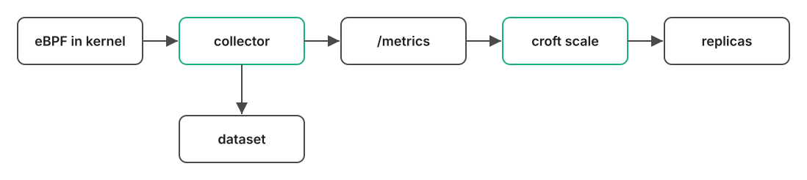
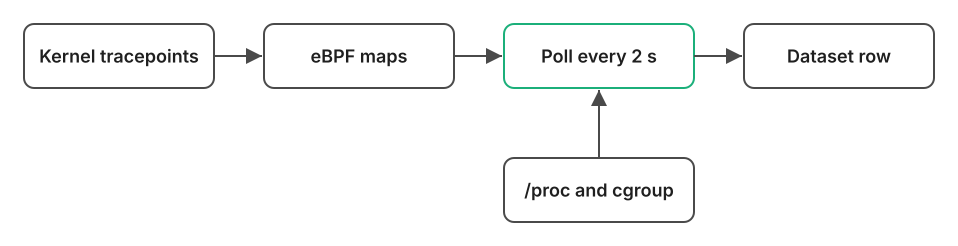

# Contributing to croft

Follow these steps and note these guidelines to begin contributing:

1. Set up the local development environment (see [Toolchain](#toolchain)).
2. Bug fixes are always welcome. Start with the open issues labelled `bug` in the
   repository's **Issues** tab.
3. A good way to start is an issue labelled `good first issue`. These describe
   what should change and where; if something is unclear, ask on the issue.

Everyone taking part follows the [Code of Conduct](CODE_OF_CONDUCT.md).

---

# How croft is organised

## Pipeline

croft reads what processes do in the kernel and decides when to scale. The
scaler is built for Kubernetes and not yet validated against the HPA; Docker
Swarm and Nomad are not built.

<p align="center">
  
</p>

The collector polls the eBPF maps every 2 s. It appends one row per process to the dataset, in JSON Lines, and serves the latest poll per container on `/metrics`. `croft scale` reads `/metrics` and sets the Deployment's replicas.

Each stage stays replaceable: a stage never depends on one to its right.

## Repository structure

```text
croft/
├── collector/                 Rust workspace
│   ├── collector/             userspace: CLI, polling, dataset writer
│   │   ├── frameworks.json    framework catalog, built in and replaceable
│   │   └── src/
│   │       ├── command/       one file per `croft` subcommand
│   │       ├── sensing/       eBPF loading, maps, syscall names and rates
│   │       ├── inspect/       /proc and cgroup readers, workload and framework
│   │       ├── pipeline/      poll reporter, dataset rows, /metrics snapshot
│   │       ├── decision/      replicas a workload needs
│   │       └── runtime/       logging, signals, terminal, HTTP
│   ├── collector-ebpf/        eBPF programs (nightly Rust, bpf-linker)
│   └── collector-common/      types shared by both sides
├── deploy/                    Docker, Kubernetes and systemd deployment
├── labs/
│   ├── k3s-cluster/           Ansible for the lab cluster
│   └── research/
│       ├── experiment/        experiment harness (uv)
│       └── apps/              applications under test
├── research/                  analysis notebooks and dataset helpers (uv)
├── agent/                     working notes for coding agents
├── website/                   documentation site (Starlight)
├── assets/                    images used by the docs
└── justfile                   task recipes
```

## How a dataset row is produced

<p align="center">
  
</p>

| Step | What happens |
|---|---|
| Kernel tracepoints | `sys_enter` counts calls per process and syscall in `SYSCALL_BY_TYPE`; GPU tracepoints fill `GPU_FDS` and `GPU_ACTIVITY` with GPU device fds and the ioctls sent through them; `sched` tracepoints add run queue wait per process |
| Poll every 2 s | userspace reads the maps and turns the counts into per-second rates |
| `/proc` and cgroup | `/proc` adds identity, framework, CPU, memory, I/O and network per process; cgroup v2 adds CPU, throttling, memory and PSI per container |
| Dataset row | one JSON line per process in `/var/lib/croft/croft-dataset.jsonl`, rotated hourly into zstd segments beside it |

The README's [What it reads](README.md#what-it-reads) table lists every tracepoint and file the collector reads.

- `collector-ebpf/src/` holds the programs attached to the tracepoints
  (`syscalls.rs`, `gpu.rs`, and `exit.rs`, which clears a process's state when it
  exits) and the maps they fill (`maps.rs`).
- `collector/src/sensing/` loads them (`ebpf.rs`), reads the maps (`maps.rs`)
  and names syscalls (`syscalls.rs`).
- `collector/src/inspect/` reads a process's identity (`process.rs`), its
  resources from `/proc` and cgroups (`resources.rs`), its GPU state
  (`classifier.rs`) and its framework (`framework.rs`).
- `collector/src/pipeline/` polls every 2 s (`reporter.rs`), turns cumulative
  counters into rates (`delta.rs`), writes rows (`dataset.rs`) and the
  `/metrics` snapshot (`metrics.rs`).
- Every row carries the container id, so experiments join their runs to the
  dataset by that id.

---

# How to contribute

## Fork the repository

Click **Fork** on the repository's main page, choose your account as the owner
and click **Create fork**. Then clone your fork:

```sh
git clone git@github.com:<your-account>/croft.git
cd croft
git config core.hooksPath .githooks
```

The last line enables the commit hooks (see [Commit messages](#commit-messages)).

## Creating an issue

- Open the **Issues** tab and click **New issue**.
- Give it a clear title. In the description, say what you expected, what
  happened, and how to reproduce it: the command, the kernel version
  (`uname -r`), and the relevant log or dataset lines.
- Preview it, then click **Submit new issue**.
- To work on it, comment on the issue and wait for a maintainer to assign it.

## Working on an issue

Create one branch per issue. Several issues on one branch make the review
harder.

```sh
git switch -c fix/short-description
```

## Toolchain

| Work on | Needs |
|---|---|
| userspace collector and CLI | Rust (stable), `just` |
| formatting | Rust nightly (`rustfmt.toml` uses unstable options) |
| eBPF programs | Rust nightly with `rust-src`, `bpf-linker` built against a matching LLVM |
| running the collector | Linux with cgroup v2 and BTF, root |
| harness and notebooks | Python 3.12+, [uv](https://astral.sh/uv) |
| experiments | a Kubernetes cluster; the lab one is set up by `labs/k3s-cluster` |

[`deploy/docker/Dockerfile`](deploy/docker/Dockerfile) shows a complete eBPF
build setup. To build and run without installing the toolchain:

```sh
docker build -f deploy/docker/Dockerfile -t croft-collector .
sudo mkdir -p /var/lib/croft
just docker-up
docker exec -it croft-collector croft top
```

## Using the justfile

Install [just](https://just.systems/man/en/introduction.html), then run these
from the repository root:

| Recipe | What it does |
|---|---|
| `just` | list the recipes |
| `just build` | build the collector and its eBPF program |
| `just build-release` | the same, in release mode |
| `just run` | build and run the collector (asks for sudo) |
| `just test` | run every test |
| `just lint` | `rustfmt --check` (nightly) and clippy with warnings as errors |
| `just fmt` | apply formatting |
| `just docker-up` | run the collector image |
| `just clean` | remove build output |

## Using uv

The Python parts use [uv](https://astral.sh/uv), the quickest way to get a
working environment at any level of comfort with Python.

```sh
cd labs/research/experiment   # or research/
uv sync
uv run run.py --help
```

The notebooks in `research/` also run in a JupyterLab container: see
`research/README.md`. `research/` is not in the repository; it holds local analysis only.

## Testing changes

Add tests with the change when the behaviour can be tested without a kernel or
a cluster.

```sh
just test    # unit tests
just lint    # formatting and clippy
```

Both build the eBPF program first, which needs `bpf-linker` and Rust nightly
(see [Toolchain](#toolchain)). Without them, skip the eBPF build: the unit
tests and clippy cover the userspace code and need no root, kernel or cluster.

```sh
cd collector
AYA_BUILD_SKIP=1 cargo test -p collector
AYA_BUILD_SKIP=1 cargo clippy -p collector --all-targets -- -D warnings
cargo +nightly fmt --all -- --check
```

With `AYA_BUILD_SKIP=1` the binary embeds an empty eBPF object, so it builds
but `croft run` cannot load its programs. Use it for tests only; build without
it, or with the Docker image, before running the collector.

Run one module's tests by name, for example `cargo test -p collector framework`.

Changes to the eBPF programs or to how rows are written also need a run on a
real host: start the collector, generate some load, and check the rows with
`croft top` and `croft stats`.

## Code style

- Clean Code first: the smallest code that solves the problem; delete before
  adding; clear names over comments.
- SOLID where it helps: one module per responsibility, small traits, no stage
  depending on one to its right. A new trait needs a second real implementation.
- DRY: one source of truth per piece of knowledge. Extend an existing helper
  before writing another.
- Comments are rare and one line. Every `unsafe` block has a `// SAFETY:`
  comment. No `unwrap()` or `expect()` in the event path.
- Files stay under 500 lines.

[`agent/code-style.md`](agent/code-style.md) has the full rules.

## Commit messages

The `commit-msg` hook checks the first line against
[Conventional Commits](https://www.conventionalcommits.org):

```text
type(scope): description
```

- Types: `feat`, `fix`, `docs`, `style`, `refactor`, `test`, `chore`, `perf`,
  `ci`, `build`, `revert`.
- Scopes: `collector`, `labs`, `apps`, `research`; omit for repository-wide
  changes.
- Lowercase, at most 72 characters, no trailing period.

```text
feat(collector): idle heartbeat and skip empty gpu fields to cut dataset growth
fix(labs): kubelet eviction reclaim 2Gi
docs: trim readme, details move to docs
```

The `pre-commit` hook runs `rustfmt`, clippy and the tests when a staged change
touches `collector/`. Without `bpf-linker` it skips the eBPF build and checks
the userspace crate (`AYA_BUILD_SKIP=1`, see [Testing changes](#testing-changes)).

## Developer Certificate of Origin

Sign off every commit with `git commit -s`. The line certifies the
[Developer Certificate of Origin](https://developercertificate.org/), so a person
adds it, never an AI tool.

CI checks the sign-off of every commit in a pull request; commits by bots are exempt.

## AI-assisted contributions

AI tools are welcome. The person who opens the pull request answers for all of it:

- Read and understand every change, and test it. It gets the same review as any other code.
- Check that the tool's terms allow contributing its output under this project's license.
- When the output holds third-party code, confirm the license allows it, and give its notice and attribution.
- Run a change to the eBPF program on a real kernel: unit tests do not run the verifier.

Say in the pull request when an AI tool wrote a substantial part of the change.

## Pushing changes

```sh
git commit -m "fix(collector): <what changed>"
git push origin fix/short-description
```

Then open your fork on GitHub, select the branch and click **Compare & pull
request**. Check that the base is the right branch of this repository, describe
what changed and how you tested it, and link the issue (`Closes #12`). Further
pushes to the same branch update the pull request.

---

# Adding to the experiments

## A load profile

Open-loop load profiles live in one table,
`labs/research/experiment/experiment/profiles.py`:

```python
PROFILES = {
    "constant": Profile("constant", 30, rps=25),
    "burst": Profile("burst", 600, base_rps=10, burst_rps=150, burst_start_s=180, burst_duration_s=120),
    # ...
}
```

A new shape adds an entry there and its rate in `Rate.at`. It is then available
as `uv run run.py web --profile <name>`. Record any profile used for a reported
result in the run's notes; `runs.jsonl` keeps its parameters.

## An application under test

Each application lives in its own folder under `labs/research/apps/`, as a
kustomization in its own namespace:

```text
labs/research/apps/<name>/
├── kustomization.yaml   namespace, resources, patches
├── namespace.yaml
├── ingress.yaml         host <name>.127.0.0.1.sslip.io on the ingress
└── hpa.yaml             the baseline autoscaler
```

Keep upstream manifests unchanged and adjust them through kustomize patches,
as `online-boutique` does. Every Deployment that should scale needs CPU
requests, or the HPA cannot compute utilization. Deploy with
`kubectl apply -k labs/research/apps/<name>`.
