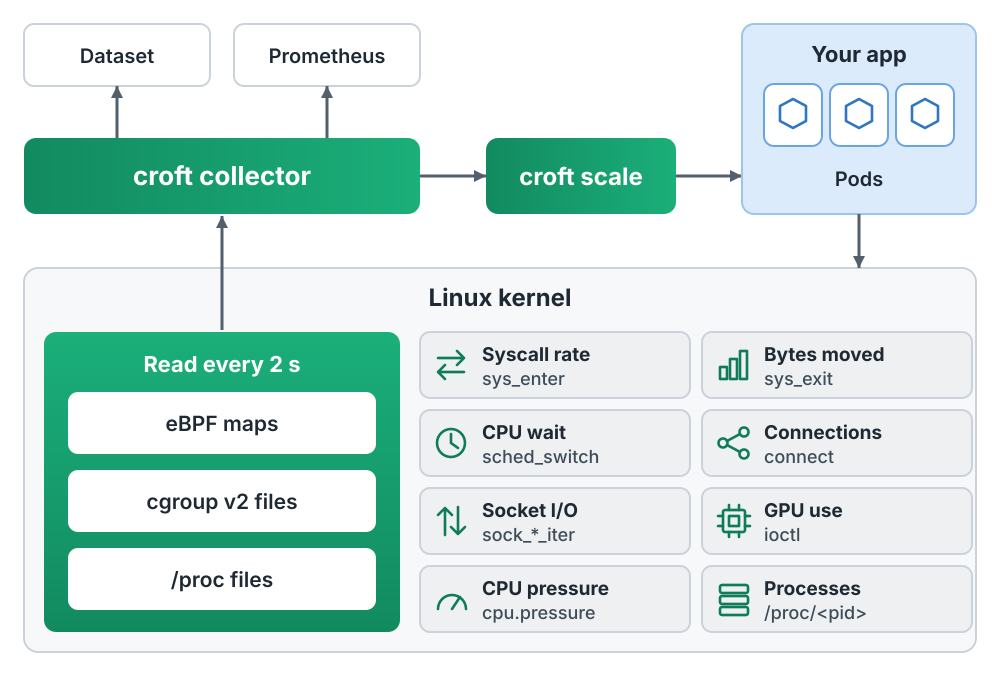

<div align="center">

# Croft

**Autoscaling that reacts to what processes do in the kernel**

[](https://github.com/danielcristho/croft/actions/workflows/ci.yml)
[](LICENSE)

[Getting started](#getting-started) · [Deployment](deploy/README.md) · [Experiments](labs/research/experiment/README.md) · [Roadmap](ROADMAP.md) · [Contributing](CONTRIBUTING.md)

</div>

Croft is a Kubernetes autoscaler for web services, built on eBPF. It watches what
each pod asks of the kernel, turns that into a request rate, and adds replicas
without waiting for average CPU to climb.

The Horizontal Pod Autoscaler (HPA) scales on CPU utilization, which rises after
requests arrive and reaches the HPA through a metrics pipeline. Requests show up
in the kernel first. A web server makes a steady number of syscalls per request,
so the rate of one syscall gives the request rate, seen from inside the node.
Multiplied by the CPU each request costs, it gives the replicas the load needs.

Croft has two parts: a collector, which runs on every node and records what each
process does, and `croft scale`, which sets the replica count of one Deployment
from the collector's signals.

<p align="center">
  
</p>

> [!IMPORTANT]
> Croft is experimental and runs in a lab cluster, not in production. The
> comparison with the HPA is still running, so this project does not yet claim an
> improvement. See [Experiments](#experiments).

## Features

### Per-container signals from the kernel

The collector attaches to kernel tracepoints and reads `/proc` and cgroup files
beside them. Every two seconds it records each container's syscall rates, CPU,
memory, throttling, pressure and run queue wait. It needs no change to the
application, no sidecar and no instrumentation library.

### Scaling on the request rate

`croft scale` reads the syscall calibrated for an application from the collector
on each node, and asks for more replicas after two polls in a row agree. It uses
the same target and the same upper bound as the HPA it replaces, and waits 300 s
before scaling down.

### A dataset for offline analysis

Each poll appends a row per process to a JSON Lines dataset, rotated and
compressed into zstd segments. `croft stats`, `croft top` and `croft profile` read
it, and `croft collect` pulls it from every node of a cluster.

### GPU workload detection

Calls to `/dev/nvidia*` show which processes hold a GPU and when they start using
it. The libraries a process loads show its framework, from a
[catalog you can extend](collector/collector/frameworks.json).

### Limited reads

The eBPF programs read user memory in two places only: the path given to `openat`,
to spot `/dev/nvidia*`, and the address given to `connect`. They do not read
syscall buffers or environment variables.

## What it reads

eBPF sees events, which no file keeps. Counters that the kernel already keeps are
read from files, at no cost to the traced processes.

| Source | Gives | Published as |
|---|---|---|
| `raw_syscalls/sys_enter` | syscall rates; the request rate of a web server | `syscalls`, `croft_container_syscall_rate` |
| `raw_syscalls/sys_exit` | bytes moved by read and write syscalls | `croft_container_syscall_bytes_total` |
| `sched_wakeup`, `sched_switch` | time each process waited for a CPU | `runqueue_s`, `croft_container_runqueue_wait` |
| `sys_enter_connect` | connect attempts by destination | `croft_container_connects_total` |
| `sock_read_iter`, `sock_write_iter` | reads and writes that reached a socket | `croft_container_socket_io_total` |
| `openat`, `ioctl`, `close` on `/dev/nvidia*` | which processes hold a GPU and when they start using it | `workload` |
| `/proc/<pid>/maps`, `cmdline` | framework, from loaded libraries or arguments | `framework` |
| `/proc/<pid>/{stat,status,io,cwd,cgroup}`, `net/dev` | CPU, RSS, threads, context switches, disk and network bytes, container | `usage`, `process` |
| cgroup v2 `cpu.stat`, `memory.current`, `*.pressure`, `memory.events` | throttling, container memory, PSI, OOM kills | `cgroup_usage`, `croft_container_cpu_*` |

The dataset's row format is in [`agent/signals.md`](agent/signals.md).

## Getting started

Build the image and start the collector on one host:

```sh
docker build -f deploy/docker/Dockerfile -t croft-collector .
sudo mkdir -p /var/lib/croft
just docker-up
docker exec -it croft-collector croft top
```

The [deployment guide](deploy/README.md) covers Kubernetes, systemd and each flag
the container needs.

### Scale a Deployment

`croft scale` needs two numbers measured for the application: the calls of one
syscall per request, and the CPU one request costs.

```sh
croft scale \
  --namespace hotel-res \
  --deployment frontend \
  --syscall write \
  --calls-per-request 11.4 \
  --cpu-per-request-ms 1.6
```

[`deploy/kubernetes/scaler.yaml`](deploy/kubernetes/scaler.yaml) runs it in a
cluster. [`RUNNING.md`](labs/research/experiment/RUNNING.md) shows how to measure
the two numbers.

## Commands

| Command | Does |
|---|---|
| `croft run` | runs the collector on this host; needs root |
| `croft top` | shows the processes of the newest poll |
| `croft stats` | summarizes datasets |
| `croft profile` | prints a container's resource profile over a window, as JSON |
| `croft deploy` | starts the collector on Docker or Kubernetes |
| `croft collect` | pulls each node's dataset from the DaemonSet |
| `croft scale` | sets a Deployment's replicas from the request rate the collectors see |

`croft <command> --help` lists the options.

## Experiments

A harness on a k3s cluster runs [DeathStarBench Hotel Reservation](https://github.com/delimitrou/DeathStarBench),
[Online Boutique](https://github.com/GoogleCloudPlatform/microservices-demo) and the
[OpenTelemetry Demo](https://github.com/open-telemetry/opentelemetry-demo) under
open-loop `burst` and `ramp` load.

- [`RUNNING.md`](labs/research/experiment/RUNNING.md): the procedure, step by step
- [`SETUP.md`](labs/research/experiment/SETUP.md): the load, autoscaling and cluster configuration

```sh
cd labs/research/experiment
uv run run.py web --app hotel-reservation --prefix burst-1 --profile burst --probes relaxed
```

## Development

```sh
just build    # userspace and eBPF program
just test     # cargo test
just lint     # fmt --check and clippy
just fmt      # apply formatting
```

The eBPF crate needs nightly Rust and `bpf-linker` built against a matching LLVM;
the [Dockerfile](deploy/docker/Dockerfile) shows the setup. Userspace-only work
does not need it.

Enable the commit hooks once per clone: `git config core.hooksPath .githooks`.

## Community

- [Contributing](CONTRIBUTING.md)
- [Code of conduct](CODE_OF_CONDUCT.md)
- [Governance](GOVERNANCE.md) and [maintainers](MAINTAINERS.md)
- [Security policy](SECURITY.md)
- [Roadmap](ROADMAP.md)

## License

Apache 2.0. See [LICENSE](LICENSE). The eBPF program is declared `Dual MIT/GPL`,
which the kernel requires for the helpers it calls.
