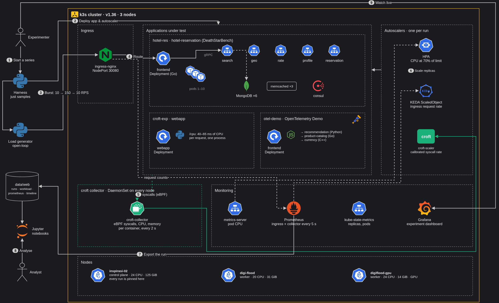

# croft Experiments — Workload Harness

This folder provides a reproducible harness for running **controlled workload experiments** on the k3s lab cluster.

Every run is recorded so croft's dataset can be joined to it exactly. croft tags every row with the container id, so a run's rows are found by that id rather than by time.

The step-by-step procedure for the autoscaler comparison is in [RUNNING.md](RUNNING.md). Deploying the applications is in [workloads/README.md](workloads/README.md).

<p align="center">
  
</p>

The diagram's source is [`assets/architecture.drawio`](assets/architecture.drawio); open it in draw.io and export the PNG again after an edit.

---

# 1. Purpose

The web experiments ask one question:

> Can an autoscaler use eBPF telemetry to see a burst early enough to add replicas before the application degrades?

Each run changes the offered load and records, for the same window, what four observers saw:

```text
the client        latency, throughput, failures
the kernel        syscall rates, through croft
the autoscaler    HPA or croft decisions
Prometheus        CPU, throttling, memory, network, replicas
```

The analysis then asks:

```text
which signal crossed its threshold first
how long the autoscaler took to add a pod
when p95 latency broke its 500 ms objective
```

---

# 2. Suites

Four suites are included.

| Suite | What runs | What is recorded |
|---|---|---|
| `gpu` | `train-cnn`, `train-transformer`, `infer-batch-cnn`, `infer-generate-lm`, `serve-http`, `serve-llm-ollama` and `gpu-idle`, each a Kubernetes Job asking for one GPU | node, pod, container id, start and end from the container status |
| `web` | an application of `apps.json` under Locust users or open-loop RPS, at fixed replicas or under an autoscaler | client latency, Prometheus series, HPA and pod events for the same window |
| `calibrate-scaler` | one application at one pinned replica, at constant loads | syscalls and CPU per request, into `data/calibration/<app>.json` |
| `compare` | nothing; it reads finished burst runs | one scored row per run, mean ± sd per arm |

The web suite takes three kinds of load:

| Load | Flag | Typical research purpose |
|---|---|---|
| Locust users at fixed levels | `--users 10 20 40 80` | capacity per replica count |
| Locust users in steps or a ramp | `--steps 2,4,8,12 [--shape ramp]` | lead time of a slow rise |
| An open-loop RPS profile | `--profile constant\|ramp\|burst\|periodic\|variable` | the response to a burst |

Use open-loop load for bursts.

A Locust user waits for each answer before sending the next request. Once the application saturates, more users mean longer queues rather than more requests, and the burst hides behind the application's own slowness.

---

# 3. Directory structure

```text
experiment/
├── README.md
├── RUNNING.md
├── justfile               recipes for the sample applications
├── apps.json              the applications under test
├── run.py                 the command line
├── experiment/            the harness
│   ├── web.py             deploy, load, export one web run
│   ├── rps.py             open-loop load generator
│   ├── profiles.py        constant, ramp, burst, periodic, variable
│   ├── prometheus.py      series export
│   ├── scaler.py          the croft arm
│   ├── calibrate_scaler.py  syscalls and CPU per request per application
│   ├── compare.py         scoring
│   └── gpu.py             the GPU suite
├── load/
│   └── locustfile.py
├── tests/
├── workloads/             manifests of the applications
└── data/                  every result, gitignored
```

---

# 4. Prerequisites

The cluster from [`labs/k3s-cluster`](../../k3s-cluster) must provide:

```text
k3s
NVIDIA device plugin                       (gpu suite)
ingress-nginx on NodePort 30080
kube-prometheus-stack
croft collector DaemonSet, WATCH_CGROUPS=kubepods
```

Each application's images must be on every node. See [workloads/README.md](workloads/README.md).

Enter the harness and install it:

```sh
cd labs/research/experiment
uv sync
export KUBECONFIG=~/.kube/croft-k3s.yaml
```

---

# 5. Commands

GPU suite:

```sh
uv run run.py gpu --dry-run                          # the plan: 7 workloads x 3 repetitions
uv run run.py gpu                                    # every GPU workload
uv run run.py gpu --only serve-llm-ollama --reps 1   # one workload
uv run run.py gpu --node gpu-node-1                  # pin to one node
```

Web suite, Locust:

```sh
uv run run.py web --prefix r10 --replicas 10                    # 10, 20, 40, 80 users at 10 fixed replicas
uv run run.py web --prefix hpa                                  # the same levels under the HPA
uv run run.py web --prefix lead --steps 2,4,8,12                # one run climbing the steps
uv run run.py web --prefix lead --steps 2,4,8,12 --shape ramp   # the same counts, one user at a time
```

Web suite, open loop:

```sh
uv run run.py web --prefix cd --profile ramp --scale 0.3                    # a ramp at 30% of its rates
uv run run.py web --prefix duo --profile burst --scaler croft               # croft scale instead of the HPA
```

Calibration and scoring:

```sh
uv run run.py calibrate-scaler --app otel-demo --node <node>   # an application's scaler entry
uv run run.py compare --prefix hpa- duo-                  # burst runs scored per arm
```

Only one experiment runs at a time (`data/experiment.lock`). Two workloads sharing CPUs pollute each other's numbers.

---

# 6. Applications

`apps.json` lists the applications under test.

A new application is a new entry, not new code. `--app` picks one.

| Field | Meaning |
|---|---|
| `namespace`, `deployment`, `container` | where the application runs; the harness selects its pods with `app=<deployment>` |
| `manifests` | a folder with `k8s.yaml` for the application and `hpa.yaml` for its baseline autoscaler |
| `host`, `path`, `health` | the ingress host, the request path the load hits, and the readiness check |
| `scaler` | the calibration croft needs: `syscall`, `calls_per_request`, `cpu_per_request_ms` |
| `scale` | the `--profile` scale a burst runs at by default |

Three applications are defined:

| Application | Request | Frontend CPU per request | Frontend limit |
|---|---|---:|---:|
| `hotel-reservation` | [DeathStarBench](https://github.com/delimitrou/DeathStarBench) hotelReservation; a hotel search across five Go services | 1.6 ms | 200m |
| `online-boutique` | [Online Boutique](https://github.com/GoogleCloudPlatform/microservices-demo) v0.10.7; the home page across a Go frontend and its product catalog, currency, cart, recommendation and ad services | 3.3 ms | 200m |
| `otel-demo` | the [OpenTelemetry Demo](https://github.com/open-telemetry/opentelemetry-demo) 3.1.0; recommendations across Node.js, Python, Go and C++ services | 5.6 ms | 300m |

The workload folders:

```text
workloads/
├── gpu/                 the GPU workloads (PyTorch, ollama), mounted into Jobs through a ConfigMap
├── hotel-reservation/   19 Deployments, their Services, the ingress and the frontend's HPA
├── online-boutique/     11 Deployments, Redis, the ingress and the frontend's HPA
├── otel-demo/           15 Deployments, a collector that drops every signal, the frontend's HPA
├── ingress-nginx/       the PodMonitor for the ingress request counts
├── monitoring/          the Grafana dashboard of a run and the croft collector's PodMonitor
└── linkerd/             the PodMonitor for the Linkerd proxies
```

---

# 7. Output

Everything lands under `data/`:

```text
data/
├── experiment.lock
├── calibration/
│   └── <app>.json               run.py calibrate-scaler
├── gpu/
│   └── runs.jsonl               one line per GPU run: label, parameters, node, container id, start and end
└── web/
    ├── runs.jsonl               one line per web run: app, load, autoscaler, window, containers
    ├── compare.csv              run.py compare: one scored row per burst run, kept across prefixes
    └── <run>/
        ├── workload.csv         open-loop runs: target and achieved RPS, latency, per second
        ├── locust_*.csv         Locust runs: stats, history, failures, exceptions
        ├── prometheus.csv       cpu_cores, cpu_throttled_fraction, memory_bytes, network, restarts, replicas
        ├── signals.csv          collector series of every service, per 5 s: syscalls, bytes, socket I/O, connects, CPU
        ├── timeline.json        HPA rescales, replica set changes from any scaler, pod created and Ready times
        ├── edges.csv            --mesh: request rate, success rate, p50 and p95 per caller and callee, every 5 s
        ├── services.csv         --mesh: CPU, throttled share, memory, restarts and replicas of every Deployment
        └── scaler.log           --scaler croft: croft's estimate every poll and its decisions
```

croft's own datasets are pulled separately:

```sh
(cd ../../k3s-cluster && ansible-playbook collect.yml)
```

They land in `research/data/nodes/<node>/` and are analysed in `research/burst_signals.ipynb` and `research/lead_time.ipynb`.

---

# 8. Experimental variables

## Independent variables

Factors deliberately changed:

```text
autoscaler arm (none, croft)
application
offered load profile and scale
```

## Dependent variables

Measured responses:

```text
time to the first scale-up
time to the first new pod Ready
peak replicas
seconds with p95 above 500 ms
failed and successful requests
replica-seconds
```

## Controlled variables

Factors kept unchanged:

```text
node the frontend runs on (CROFT_NODE)
frontend CPU request and limit
capacity model: a pod is full at 70% of its CPU limit
replica bounds: 1 to 10
probes: relaxed
warm-up, profile duration, cool-down
Prometheus scrape interval
no other workload on the cluster
```

Avoid changing several independent variables at once.

---

# 9. Design notes

**Probe timeouts are 5 s, not the 1 s default.**

Under CPU starvation a 1 s probe marks a slow pod dead, the kubelet restarts it, and the run records restarts instead of load.

**Requests equal limits.**

Each frontend asks for the CPU it is limited to, so the HPA's 70% target means 70% of the limit per pod. With a request at half the limit, the same target would sit at 35% of what a pod can use. The hotel and Online Boutique frontends ask for 200m, the otel frontend for 300m.

**A step jumps the load at once.**

Every signal reacts within a poll, so croft can lead the objective by one poll at most. A ramp spreads the same rise and shows lead time.

**Failed requests are data.**

Locust runs with `--exit-code-on-error 0`.

**Throttling is a share of CFS periods.**

kube-prometheus-stack drops `container_cpu_cfs_throttled_seconds_total`, so `cpu_throttled_fraction` divides throttled periods by all periods.

**The open-loop profiles follow cloud2023.**

`--profile` uses the rates of `cloud-dynamics-experiments`, a 30 s warm-up at 5 RPS and a 15 s cool-down, and writes `workload.csv` with the same columns. Each application needs its own `--scale` to keep a burst within ten pods.

**`--scaler croft`**

deploys `deploy/kubernetes/scaler.yaml` for the application before the warm-up, saves its log and removes it after the run. It needs the collector with `CROFT_METRICS_ADDR` set.

**`--mesh`**

annotates the application's namespace with `linkerd.io/inject: enabled` and restarts the application through `just restart` when a running pod's proxy disagrees; a run without it removes the annotation and the proxies the same way. Each run then writes `edges.csv` from the proxies' `response_total` and `response_latency_ms`, with `ingress` as the caller of the frontend, and `services.csv` for every Deployment, and records `"mesh": "linkerd"` in `runs.jsonl`.

The frontend HPAs target the application container (`ContainerResource`), and `cpu_cores` and `cpu_throttled_fraction` leave the `linkerd-proxy` container out, so 70% stays 70% of the application's own CPU. The network columns are counted per pod and include the proxy's traffic.

`--mesh` is refused with `--scaler croft`: `croft scale` reads the first container's CPU request and counts the syscalls of every container in the pod, the proxy's too.

**`--concurrent`**

takes a shared lock on `data/experiment.lock` and an exclusive one on `data/experiment-<app>.lock`, so runs of different applications overlap while two runs of one application, or any run without the flag, still wait. The run records `"concurrent": true`, and `compare` keeps concurrent and exclusive runs in separate groups. The applications still share ingress-nginx, Prometheus, the load generator and the nodes their unpinned backends land on. `--concurrent` is refused with `--scaler croft`.

**GPU images are pulled on first use.**

ollama models are cached per node in `/var/lib/croft/ollama`.

---

# 10. Reference

The web suite's design follows the workload experiments in [rm77/cloud2023](https://github.com/rm77/cloud2023), `kubernetes/research/experiments`:

```text
load against a CPU-bound service
Prometheus series exported for the measurement window
one run per load level
```

Its open-loop profiles follow `kubernetes/research/cloud-dynamics-experiments` in the same repository.

The code here is written for croft and does not copy it.
