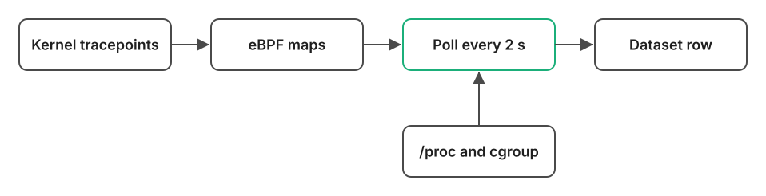

Start with an issue labelled `good first issue`: these say what should change and where. Comment on the issue before working on it. Everyone taking part follows the [Code of Conduct](https://github.com/danielcristho/croft/blob/main/CODE_OF_CONDUCT.md).

## Toolchain

| Work on | Needs |
|---|---|
| userspace collector and CLI | Rust (stable), `just` |
| formatting | Rust nightly (`rustfmt.toml` uses unstable options) |
| eBPF programs | Rust nightly with `rust-src`, `bpf-linker` built against a matching LLVM |
| running the collector | Linux with cgroup v2 and BTF, root |
| harness and notebooks | Python 3.12+, [uv](https://astral.sh/uv) |
| this site | Node.js 22.22 or later |

```sh
git clone git@github.com:<your-account>/croft.git
cd croft
git config core.hooksPath .githooks
```

## Repository layout

```text
croft/
├── collector/                 Rust workspace
│   ├── collector/             userspace: CLI, polling, dataset writer
│   │   ├── frameworks.json    framework catalog, built in and replaceable
│   │   └── src/
│   │       ├── command/       one file per croft subcommand
│   │       ├── sensing/       eBPF loading, maps, syscall names and rates
│   │       ├── inspect/       /proc and cgroup readers, workload and framework
│   │       ├── pipeline/      poll reporter, dataset rows, segments, /metrics
│   │       ├── decision/      replicas a workload needs
│   │       └── runtime/       logging, signals, terminal, HTTP
│   ├── collector-ebpf/        eBPF programs (nightly Rust, bpf-linker)
│   └── collector-common/      types shared by both sides
├── deploy/                    Docker, Kubernetes and systemd deployment
├── labs/
│   ├── k3s-cluster/           Ansible for the lab cluster
│   └── research/experiment/   experiment harness (uv)
├── website/                   this site
└── justfile                   task recipes
```

## How a row is produced



| Step | What happens |
|---|---|
| Kernel tracepoints | `sys_enter` counts calls per process and syscall in `SYSCALL_BY_TYPE`; GPU tracepoints fill `GPU_FDS` and `GPU_ACTIVITY` with GPU device fds and the ioctls sent through them; `sched` tracepoints add run queue wait per process |
| Poll every 2 s | userspace reads the maps and turns the counts into per-second rates |
| `/proc` and cgroup | `/proc` adds identity, framework, CPU, memory, I/O and network per process; cgroup v2 adds CPU, throttling, memory and PSI per container |
| Dataset row | one JSON line per process in `/var/lib/croft/croft-dataset.jsonl`, rotated hourly into zstd segments beside it |

[Data sources](/reference/data-sources/) lists every tracepoint and file the collector reads.

## Tests

```sh
just test    # unit tests
just lint    # rustfmt --check (nightly) and clippy with warnings as errors
```

Both build the eBPF program first. Without `bpf-linker`, skip it; the unit tests and clippy cover the userspace code and need no root, kernel or cluster:

```sh
cd collector
AYA_BUILD_SKIP=1 cargo test -p collector
AYA_BUILD_SKIP=1 cargo clippy -p collector --all-targets -- -D warnings
cargo +nightly fmt --all -- --check
```

With `AYA_BUILD_SKIP=1` the binary embeds an empty eBPF object: it builds, but `croft run` cannot load its programs. Changes to the eBPF programs or to how rows are written also need a run on a real host, checked with `croft top` and `croft stats`.

## Code style

- The smallest code that solves the problem; delete before adding; clear names over comments.
- One module per responsibility; no stage depends on one to its right.
- One source of truth per piece of knowledge; lists that grow go in a JSON file, not in code.
- Comments are rare and one line. Every `unsafe` block has a `// SAFETY:` comment. No `unwrap()` or `expect()` in the event path.
- Files stay under 500 lines.

## Commits

The `commit-msg` hook checks the first line against [Conventional Commits](https://www.conventionalcommits.org): `type(scope): description`, lowercase, at most 72 characters, no trailing period. Scopes: `collector`, `labs`, `apps`, `research`, `website`; omit for repository-wide changes.

The `pre-commit` hook runs rustfmt, clippy and the tests when a staged change touches `collector/`.

## Bots

| Workflow | Does |
|---|---|
| Dependabot | weekly updates for Cargo, GitHub Actions, npm (`website/`), uv (`labs/research/experiment`) and Docker; minor and patch bumps come as one pull request per ecosystem, aya as its own |
| `pr-title` | checks the pull request title against the commit rule above, since a squash merge turns it into the commit on `main` |
| `links` | checks the Markdown links on pull requests that touch Markdown, and weekly; a broken link there opens a `[DOCS] broken links` issue |
| `release` | Release Please, below |

## Releases

Release Please reads the Conventional Commits on `main` and keeps a release pull request open: `feat` raises the minor version, `fix` the patch, while the version is below 1.0. The pull request updates `CHANGELOG.md`, the workspace version in `collector/Cargo.toml`, `Cargo.lock` and the chart `version` in `deploy/helm/croft/Chart.yaml`.

Merging it tags `vX.Y.Z`, publishes a GitHub release and pushes `ghcr.io/danielcristho/croft:X.Y.Z`. The chart's `appVersion` stays `main` until the first release image exists.

The current version lives in `.release-please-manifest.json`. To release a chosen version, such as 1.0.0, set `"release-as": "1.0.0"` in `release-please-config.json` before merging, and remove it afterwards.

## This site

```sh
cd website
npm install
npm run dev       # http://localhost:4321/
npm run build     # static site in website/dist
```

Pages are Markdown in `website/src/content/docs/`; the sidebar follows the folders.
